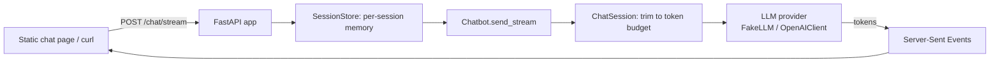

<p align="center"></p>

<h1 align="center">LLM Chatbot Template</h1>

<p align="center">
  <strong>A streaming LLM chatbot backend template in Python (FastAPI) — SSE token streaming, in-memory session memory, and a pluggable LLM client that runs fully offline.</strong><br>
  Clone it, run it with zero API keys, then swap in OpenAI (or any compatible backend) when you go live.
</p>

<p align="center">
  <em>Built and maintained by <a href="https://viprasol.com">Viprasol Tech</a> — Fintech Experts. Full-Stack Builders.</em>
</p>

<p align="center">
  <a href="https://github.com/Viprasol-Tech/llm-chatbot-template/actions/workflows/ci.yml"></a>
  <a href="LICENSE"></a>
  
  <a href="https://github.com/astral-sh/ruff"></a>
  <a href="https://t.me/viprasol_help"></a>
  <a href="https://github.com/Viprasol-Tech/llm-chatbot-template/stargazers"></a>
</p>

---

> **Offline-first.** The default provider is a deterministic `FakeLLM`, so the server, the demo, and the entire test-suite run with **no API keys and no network**. Point it at OpenAI (or any OpenAI-compatible endpoint) with one environment variable when you're ready.
>
> _Note: this is a template to build on, not a production-hardened framework — review and adapt before shipping._

## ✨ Features

- 🌊 **SSE token streaming** — `POST /chat/stream` streams the reply token-by-token over Server-Sent Events.
- ⚡ **FastAPI backend** — typed request/response models, OpenAPI docs at `/docs`, ASGI-ready.
- 🧠 **In-memory session memory** — per-`session_id` conversation history, isolated and resettable.
- 🔌 **Pluggable LLM client** — a tiny `LLM` protocol (`complete` + `stream`); bring any model.
- 🤖 **Offline FakeLLM** — deterministic, zero-dependency provider for demos and tests.
- 🟢 **Optional OpenAI client** — OpenAI-compatible client with the SDK imported *lazily*.
- ✂️ **Token-budget trimming** — drops oldest turns first, always keeping the system prompt.
- 💬 **Static chat UI** — a self-contained HTML page served at `/` that streams live.
- 🖥️ **Typer CLI** — `demo`, `serve`, and `version` commands out of the box.
- 🐳 **Docker-ready** — Dockerfile + docker-compose run uvicorn with a healthcheck.
- ⚙️ **Env-based config** — `pydantic-settings` reads `CHATBOT_*` vars and `.env`.
- ✅ **Strict tooling & CI** — ruff, mypy (strict), pytest, GitHub Actions on Linux/macOS/Windows × Py 3.11–3.13.

## 🚀 Quickstart

```bash
git clone https://github.com/Viprasol-Tech/llm-chatbot-template.git
cd llm-chatbot-template
python -m pip install -e ".[dev,serve]"

# Run the offline CLI demo (no keys, no network):
llm-chatbot-template demo --stream

# Or start the streaming server and open http://127.0.0.1:8000
llm-chatbot-template serve
```

Stream a reply from the running server:

```bash
curl -N -X POST http://127.0.0.1:8000/chat/stream \
  -H "Content-Type: application/json" \
  -d '{"session_id": "demo", "message": "Hello there!"}'
```

Prefer containers? `docker compose up --build` then open <http://127.0.0.1:8000>.

## 🧩 Usage

Use the engine directly in Python — the same `Chatbot` the API is built on:

```python
from llm_chatbot_template.chat import Chatbot
from llm_chatbot_template.providers import FakeLLM

bot = Chatbot(FakeLLM(), system_prompt="You are concise.", max_tokens=128)

# Blocking reply:
print(bot.send("Hello!"))               # -> "Echo: you said 'Hello!'"

# Streamed reply (token-by-token):
for chunk in bot.send_stream("And again?"):
    print(chunk, end="", flush=True)
```

Go live by switching the provider — the `openai` SDK is imported only when used:

```bash
export CHATBOT_PROVIDER=openai
export CHATBOT_OPENAI_API_KEY=sk-...      # or any OpenAI-compatible base_url
llm-chatbot-template serve
```

A runnable, offline end-to-end script lives in [`examples/quickstart.py`](examples/quickstart.py).

## 🗺️ Architecture



## 📚 Endpoints

| Method | Path           | Description                              |
| ------ | -------------- | ---------------------------------------- |
| `GET`  | `/`            | Static streaming chat page               |
| `GET`  | `/health`      | Liveness + active provider + session count |
| `POST` | `/chat`        | Blocking JSON reply                      |
| `POST` | `/chat/stream` | SSE token-by-token reply                 |
| `POST` | `/reset`       | Clear a session's memory                 |

## 🧭 Roadmap

- [x] FastAPI SSE streaming `/chat` endpoint
- [x] In-memory per-session conversation memory
- [x] Pluggable LLM protocol + offline `FakeLLM` + optional OpenAI client
- [x] Static chat UI, Dockerfile, and CLI
- [ ] Pluggable tokenizers (tiktoken adapter) behind the estimator
- [ ] Persistent session stores (Redis / SQLite)
- [ ] WebSocket transport alongside SSE
- [ ] Streaming tool/function-calling support

## 🤝 Contributing

PRs welcome — see [CONTRIBUTING.md](CONTRIBUTING.md) and our [Code of Conduct](CODE_OF_CONDUCT.md).
Run `python -m ruff check . && python -m mypy src && python -m pytest` before opening a PR.

## 📬 Contact — Viprasol Tech Private Limited

- 🌐 Website: [viprasol.com](https://viprasol.com)
- ✉️ Email: [support@viprasol.com](mailto:support@viprasol.com)
- 💬 Telegram: [t.me/viprasol_help](https://t.me/viprasol_help) · 📱 WhatsApp: +91 96336 52112
- 🐙 GitHub: [@Viprasol-Tech](https://github.com/Viprasol-Tech) · 💼 [LinkedIn](https://www.linkedin.com/in/viprasol/) · 𝕏 [@viprasol](https://twitter.com/viprasol)

> *Viprasol Tech — fintech software, algorithmic trading systems, MT4/MT5 bots, AI voice agents, and B2B SaaS. Need a custom build? [Get in touch](mailto:support@viprasol.com).*

## 📄 License

[MIT](LICENSE) © 2025 Viprasol Tech Private Limited
